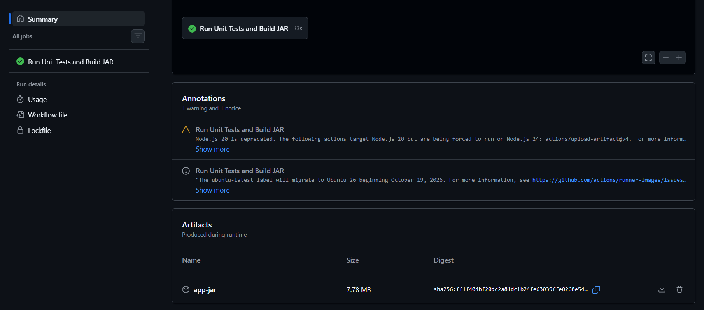

# Bài tập 2: Biên dịch đóng gói tệp ứng dụng .jar với Gradle và lưu trữ Artifacts

- **Môn học:** IT215 - Cloud Infrastructure & DevOps Fundamentals
- **Học viên:** Trần Đức Anh

---

## 1. Mục tiêu

- Thực thi câu lệnh biên dịch và đóng gói ứng dụng Spring Boot thành tệp thực thi `.jar` bằng Gradle (`./gradlew bootJar`).
- Lưu trữ thành phẩm biên dịch (`.jar`) từ thư mục `build/libs/` lên GitHub Actions bằng `actions/upload-artifact@v4`.
- Cho phép tải về tệp artifact `app-jar` trực tiếp từ giao diện Actions Summary.

---

## 2. Cấu trúc thư mục dự án

```text
ss11/ex2/
├── .github/
│   └── workflows/
│       └── ci.yml
├── gradle/
│   └── wrapper/
│       ├── gradle-wrapper.jar
│       └── gradle-wrapper.properties
├── src/
│   ├── main/java/com/example/ex11/Ex11Application.java
│   └── test/java/com/example/ex11/Ex11ApplicationTests.java
├── build.gradle
├── ci-ex2-ss11.png
├── gradlew
├── gradlew.bat
├── settings.gradle
├── .gitignore
└── README.md
```

---

## 3. Nội dung tệp kịch bản CI Workflow (`.github/workflows/ci.yml`)

```yaml
name: Java Spring Boot CI (Gradle)

on:
  push:
    branches: [ "main" ]

jobs:
  test:
    name: Run Unit Tests and Build JAR
    runs-on: ubuntu-latest

    steps:
      - name: Checkout mã nguồn
        uses: actions/checkout@v5

      - name: Thiết lập môi trường Java JDK 17
        uses: actions/setup-java@v5
        with:
          java-version: '17'
          distribution: 'temurin'

      - name: Cấp quyền cho Gradle Wrapper
        run: chmod +x gradlew

      - name: Thực thi JUnit Test với Gradle
        run: ./gradlew test

      - name: Đóng gói tệp JAR với Gradle
        run: ./gradlew bootJar

      - name: Lưu trữ thành phẩm JAR Artifact
        uses: actions/upload-artifact@v4
        with:
          name: app-jar
          path: build/libs/*.jar
```

---

## 4. Giải thích các bước bổ sung trong Workflow

1. **`run: ./gradlew bootJar`**:
   - Sử dụng Spring Boot Gradle Plugin để đóng gói toàn bộ mã nguồn, cấu hình và thư viện phụ thuộc (fat JAR / executable JAR) vào tệp `.jar` đặt trong thư mục `build/libs/`.
2. **`actions/upload-artifact@v4`**:
   - Thu thập các tệp theo đường dẫn `build/libs/*.jar`.
   - Nén và tải lên hệ thống lưu trữ tạm thời của GitHub Actions với tên định danh `app-jar`.
   - Giúp các workflow khác hoặc người dùng có thể tải về chạy thử hoặc phục vụ cho bước release/deployment.

---

## 5. Kết quả kiểm tra trên GitHub Actions

Ảnh chụp màn hình thực tế phần Summary trên tab Actions hiển thị Job **Run Unit Tests and Build JAR** hoàn thành và đính kèm Artifact thành công:



### Chi tiết kết quả:
- **Trạng thái Job:** `Run Unit Tests and Build JAR` thành công (tích xanh) trong **33s**.
- **Mục Artifacts:**
  - Tên artifact: `app-jar`
  - Dung lượng: `7.78 MB`
  - Mã băm: `sha256:ff1f404bf20dc2a81dc1b24fe63039ffe0268e54...`
  - Hỗ trợ tải trực tiếp tệp nén `app-jar.zip` về máy tính.

---

## 6. Kết luận

- Pipeline CI đã được mở rộng thành công, không chỉ kiểm thử tự động mà còn tạo và xuất xưởng thành phẩm đóng gói (.jar) sẵn sàng cho môi trường triển khai.
